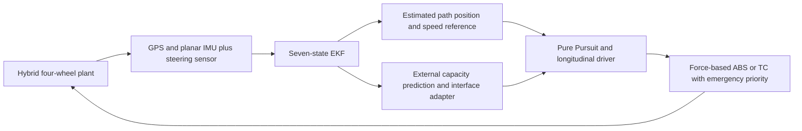

# Current runnable state

**Active update — 27 November 2026:** stateful modulated ABS is installed. Working Q is `diag([.001 .001 .00001 .003 .003].^2)`; sensor noise, R, P0, EKF equations, TC and physical dynamics are unchanged. [New results and videos](../Results/Modulated_ABS/README.md) · [Decision and research](../Documentation/Design_Decisions/Modulated_ABS_2026-11-27.md) · [Previous package](../Archive/2026-11-27_Before_Modulated_ABS/README.md).

[← Project](../README.md) · [Closed-loop results](../Results/Closed_Loop/README.md) · [Theory](../Documentation/Dynamics_Development.md) · [Q and failure analysis](../Documentation/Estimator_Q_and_Failure_Analysis.md)

**The sensing–estimation–control loop is connected and has completed the fourteen-corner circuit.** This is the active entry point, superseding the historical V12 and early block-extraction harnesses.

```matlab
cd(fullfile('PROJECT','Current State'))
open('Integracion_estado_actual.mlx')
% Run the entire Live Script.
```

MATLAB R2026a was used. Do not recursively add every historical model or Source Exports folder to the path. The Live Script checks that it resolves the functions from this package.

## What runs

The default configuration compares ABS off/on with TC enabled in both complete noisy/estimated loops. The optional perfect-state reference is disabled by default. It preserves the same track, driver, force limits, tyre parameters and speed plan. The reference maximum is 35 m/s; this is a cap, not a promise that every case achieves it.

| Case | Lap time | Maximum path error | Position-estimator RMSE |
|---|---:|---:|---:|
| Estimated loop, ABS off / TC on | 49.250 s | 2.016 m | 0.14452 m |
| Estimated loop, modulated ABS on / TC on | 47.294 s | 0.35427 m | 0.14233 m |

These are seed-1 simulation results, not a robustness claim or a full-body cone-clearance check. The `.m` and `.mlx` entry points contain the same integration source.

## Block connections



The estimator does not receive true plant states or tyre memories. True position is used only to produce GPS, set the declared known initial condition and evaluate the run. The speed-profile query uses estimated position. The perfect-state case is an explicit comparison, never a silent fallback.

| Component | Files and responsibility |
|---|---|
| [Dynamics](Dinamica/) | Rear traction-only Pacejka, historical braking, Ackermann and consistent slip-angle geometry |
| [Sensors](Sensores/sensores.m) | Noisy `ax`, `ay`, yaw rate, intermittent GPS and equivalent steering angle |
| [Estimator](Estimacion/estimadorEstado.m) | State `[X,Y,psi,vx,vy,ay,delta]`; IMU prediction and GPS correction |
| [Control](Control/controlTotal.m) | Existing longitudinal/lateral controllers, force ABS/TC and latched emergency arbitration |
| [Capacity prediction](estimarCapacidadControl.m) | Controller-owned deterministic load/capacity/braking-memory model |
| [Legacy-input adapter](adaptarEntradaControl.m) | Converts estimated signals and controller calculations to the unchanged controller input layout |
| [Configuration](Configuracion/configuracionIntegracion.m) | Sensor errors, EKF uncertainty, run options and output destination |

The original full-loop connection preserved thirteen existing block functions. This later approved update changes ABS and its coordinator memory/configuration; the other blocks remain byte-exact. The new connection is external. `zControl` in the adapter is a compatibility vector, **not** a reconstructed true tyre state: its unused slots are documented in the source. Controller memories are calculated internally; they are not sensors and receive no additional random noise. The nominal friction coefficient is assumed known, not identified online.

## Output and language policy

New local runs write to this package's `Resultados` folder, configured by `cfg.carpetaResultados`. Published evidence is indexed separately under [Results](../Results/README.md). Existing evidence is not moved or overwritten by publication.

Documentation is in English. MATLAB identifiers and comments remain in Spanish as requested, with source hashes in the [manifest](../Documentation/closed_loop_artifact_manifest.json). Recorded video/plot labels retain the language of their original render.

## Important limits

- No ESC yaw-stability controller has been added. ABS/TC do not directly correct steering.
- ABS/TC limit force demands; they are not wheel-slip feedback regulators.
- Rear wheel rotation is dynamic during traction. Front wheels are kinematic; all wheel speeds are diagnostic reconstructions during historical braking.
- The plant disallows mixed positive driving and negative braking commands across wheels.
- The EKF does not estimate IMU bias, friction or physical tyre-memory states.
- The plant clamps longitudinal velocity to zero; the EKF does not reproduce that constraint. Extreme uncontrolled spins expose this mismatch.
- Working Q returns to the reduced configuration. Restored-Q and X/Y-only failures are documented separately; no experimental validation or robustness claim follows from the successful lap.
