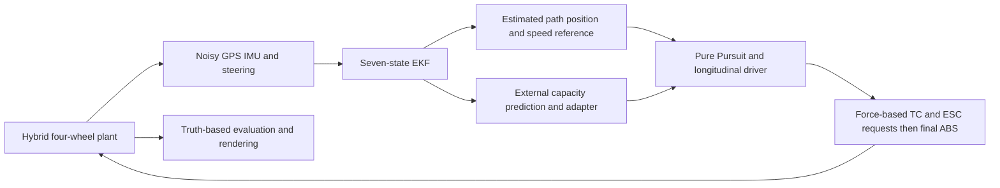

# Project overview

**Latest state — 28 November:** the new **33-corner complete sensing/EKF loop with ABS, TC and ESC** completes in **191.074 s**. [Official video and perfect-state comparison](Results/Extreme_33_Corners/README.md) · [Runnable harness](Current%20State/Ensayos_circuito_extremo/README.md). The retained moose benchmark remains a separate perfect-state test.

[← Repository](../README.md) · [Current package](Current%20State/README.md) · [Results](Results/README.md) · [Theory](Documentation/Dynamics_Development.md) · [Design history](Documentation/README.md)

**A four-wheel vehicle model connected to noisy sensors, state estimation and force-based control.**

The snapshot dated **28 November 2026** includes the complete sensing–estimation loop, rear traction-only Pacejka, historical braking, Ackermann geometry and force-based ABS/TC. ESC V1 is now connected to estimated signals in the dedicated 33-corner harness. Force-comparison ABS/TC are intentional academic controllers; production slip-feedback regulation and experimental tyre identification are outside the stated scope. Remaining validation includes multiple noise seeds, targeted aid tests and emergency scenarios. V1–V12 remain historical development stages, with later milestones documented separately.

## Project layout

The original coursework/project separation is retained. Directory headings and documentation are English; active MATLAB identifiers and comments remain Spanish as requested.

```text
PROJECT/
├── Current State/    Active complete-loop package and local output folder
├── Dynamic Model/    V1–V8 plant and archived later alternatives
├── Hybrid Tests/     Tracking, planning and V8–V12 stress scenarios
├── Results/          Recorded figures, videos, metrics and telemetry
├── Documentation/    Theory, decisions, chronology and limitations
└── Tools/            Reproduction and publication checks
```

| Directory | Start here |
|---|---|
| [Current State](Current%20State/README.md) | Active dynamics, sensors, EKF, control and complete-loop Live Script |
| [Dynamic Model](Dynamic%20Model/README.md) | Historical prototypes, V1–V8 and archived later physical alternatives |
| [Hybrid Tests](Hybrid%20Tests/README.md) | V8 tracking and V9–V12 planning/stress scenarios |
| [Results](Results/README.md) | Current complete-loop evidence, tyre-model experiments and historical campaigns |
| [Documentation](Documentation/README.md) | Theory, decisions, Q analysis and milestones |
| [Modular Architecture](Modular%20Architecture/README.md) | Historical plant-only extraction and simulation harness |
| [Blocks](Blocks/README.md) | Historical callable-block extraction, superseded by Current State |

## Run a scenario

MATLAB **R2026a** was used for verification and rendering. Earlier releases have not been certified. Native graphics provide the historical 3D scenes without an additional visualization library; the vehicle physics remains planar.

| Objective | MATLAB Current Folder | Live Script |
|---|---|---|
| Run the complete estimated loop | `PROJECT/Current State` | `Integracion_estado_actual.mlx` |
| Inspect historical V8 | `PROJECT/Dynamic Model` | `CuatroruedasV8_bloqueo_ruedas.mlx` |
| Track a path with the earlier speed plan | `PROJECT/Hybrid Tests` | `Prueba_hibrida_V9_PurePursuit_animada.mlx` |
| Follow the earlier single car in 3D | `PROJECT/Hybrid Tests` | `Prueba_hibrida_V11_35ms_3D.mlx` |
| Inspect the V12 acceleration stress test | `PROJECT/Hybrid Tests` | `Prueba_hibrida_V12_35ms_3D_Aceleracion_agresiva.mlx` |

Run each `.mlx` in full. The current entry point loads only its package functions and writes future output to `Current State/Resultados`. Historical V8 helpers use `Ensayos`; the older interactive players do not automatically use the current EKF. **Source Exports** are kept separately to avoid same-name script shadowing. Do not recursively add historical model/export folders to the path.

## Architecture



The estimated loop never silently substitutes the true tyre state. Controller-owned braking memories are deterministic calculations, not fictitious sensor channels. The thirteen existing block functions were preserved when the loop was connected; its integration uses external adapters. The current plant contract is:

```matlab
[z_next, tele] = pasoDinamicoSoloTraccion(z, u, p, dt);
u = [FxDI; FxDD; FxTI; FxTD; delta];
```

`z_next` has 24 components, including motion, historical memories and four wheel-speed values. Rear rotation is dynamic in traction; braking uses reconstructed wheel-speed diagnostics. The input also accepts `[FxTotal;delta]`, and mixed positive/negative wheel demands are rejected. [Current contract and limitations →](Current%20State/README.md)

## Earlier fourteen-corner benchmark (instantaneous ABS)

| Configuration | Lap time [s] | Maximum path error [m] | Position-estimator RMSE [m] |
|---|---:|---:|---:|
| Estimated loop, ABS/TC on | 47.370 | 0.350 | 0.142 |
| Estimated loop, ABS/TC off | 101.228 | 7.258 | 3.145 |
| Perfect-state reference, ABS/TC on | 47.132 | 0.329 | — |

The uncontrolled route completion includes corridor departures. The first controlled attempt with inherited Q failed at 6.046 s; its video and histories are retained. The later Q adjustment is provisional, and the plant's `vx >= 0` clamp is not reproduced by the EKF during extreme motion. [Evidence and definitions →](Results/Closed_Loop/README.md) · [Q and failure analysis →](Documentation/Estimator_Q_and_Failure_Analysis.md)

## Historical V10–V12 results

Same 631.56 m stress circuit and 35 m/s speed cap, before the current tyre/estimator changes:

| Configuration | Lap time [s] | Maximum lateral error [m] | CG outside track [%] |
|---|---:|---:|---:|
| V10 — baseline mapping | 51.384 | 1.263 | 0 |
| V11 — demanding mapping | 47.680 | 0.776 | 0 |
| V12 — extreme acceleration | 149.036 | 4.347 | 18.103 |

V11 changed planning assumptions. V12 doubled the maximum requested driving force from 2500 to 5000 N and reduced its application time constant from 0.030 to 0.010 s, without changing that stage's plant equations. [Historical comparison →](Results/README.md)

## Interpretation and next steps

Completing a lap does not establish track containment or physical validity. Historical track-exit statistics use the centre of gravity, not the body envelope; lock statistics refer to the relevant model's approximation. A speed cap may never be reached.

Next, review extreme-motion plant/estimator consistency, test ABS and TC separately and across additional noise seeds, and validate the now-connected ESC V1 across targeted manoeuvres. Lower Q cannot repair missing dynamics or unestimated bias. Internal block changes require review; the current loop was connected externally.

The [earlier Blocks package](Blocks/README.md) and [plant-only Modular Architecture template](Modular%20Architecture/README.md) remain historical snapshots. Their four-state EKF and total-force plant do not describe the current runnable package. [History](Documentation/Versions/README.md) preserves V1–V12 and [later milestones](Documentation/Versions/After_V12/README.md) without inventing additional version numbers.
