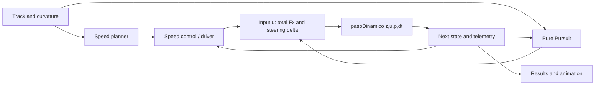

# Project overview

[← Repository](../README.md) · [Plant](Dynamic%20Model/README.md) · [Hybrid tests](Hybrid%20Tests/README.md) · [Results](Results/README.md) · [Design history](Documentation/README.md)

**Develop a Formula Student Driverless vehicle model and prepare coordinated stability control around it.**

The long-term objective is an ESC coordinating selective braking, traction management and steering correction. This snapshot contains the plant evolution and test environments through **V12**. ESC, ABS and TCS have not yet been implemented.

## Project layout

The original separation between root-level coursework and the main project is retained. New directories follow the repository's existing English naming style; historical MATLAB filenames are kept for compatibility.

```text
PROJECT/
├── Dynamic Model/    Four-wheel plant V1–V8 and manoeuvre scripts
├── Hybrid Tests/     Tracking, planning, stress tests and animation
├── Results/          Figures, videos, metrics and telemetry
├── Documentation/    Decisions, version history and intermediate slides
└── Tools/            Reproduction and publication checks
```

| Directory | Start here |
|---|---|
| [Dynamic Model](Dynamic%20Model/README.md) | Prototypes, V1–V8 and the Ensayos subdirectory |
| [Hybrid Tests](Hybrid%20Tests/README.md) | V8 tracking and V9–V12 planning/stress scenarios |
| [Results](Results/README.md) | Ten videos, figures and data from 50 recorded histories |
| [Documentation](Documentation/README.md) | Twelve stages, design decisions and known limitations |
| [Modular Architecture](Modular%20Architecture/README.md) | New integration stage: standalone frozen dynamic block and editable simulation harness |

## Run a scenario

MATLAB **R2026a** was used to verify recent simulations and generate the videos. Native `patch`, `hgtransform` and camera functions provide the 3D display without an additional visualization library. Earlier MATLAB releases have not been certified.

| Objective | MATLAB Current Folder | Live Script |
|---|---|---|
| Inspect the reference plant | `PROJECT/Dynamic Model` | `CuatroruedasV8_bloqueo_ruedas.mlx` |
| Track a path with a speed plan | `PROJECT/Hybrid Tests` | `Prueba_hibrida_V9_PurePursuit_animada.mlx` |
| Follow one car in 3D | `PROJECT/Hybrid Tests` | `Prueba_hibrida_V11_35ms_3D.mlx` |
| Stress acceleration adhesion | `PROJECT/Hybrid Tests` | `Prueba_hibrida_V12_35ms_3D_Aceleracion_agresiva.mlx` |

Run each `.mlx` in full. The plant script finds its manoeuvre helpers through `fullfile(pwd,'Ensayos')`. The interactive player provides pause, restart, a time slider and camera selection; closing it deletes its timer.

**Source Exports** contains readable `.m` copies, separate from the original `.mlx` files to prevent same-name script shadowing. Do not recursively add every historical export to the MATLAB path.

## Architecture



This diagram describes the existing implementation, not the future ESC integration diagram. The plant remains frozen during the next architecture phase:

```matlab
[z_next, tele] = pasoDinamico(z, u, p, dt);
```

`z_next` is the entire next state, including adhesion and lock-mode memories, rather than position alone. [Full interface contract →](Dynamic%20Model/README.md#plant-interface)

## Reference results

Same 631.56 m stress circuit and 35 m/s speed cap:

| Configuration | Lap time [s] | Maximum lateral error [m] | CG outside track [%] |
|---|---:|---:|---:|
| V10 — baseline mapping | 51.384 | 1.263 | 0 |
| V11 — demanding mapping | 47.680 | 0.776 | 0 |
| V12 — extreme acceleration | 149.036 | 4.347 | 18.103 |

V11 changes planning assumptions, not plant adhesion limits. V12 doubles the maximum requested driving force from 2500 to 5000 N and reduces its application time constant from 0.030 to 0.010 s; braking and plant equations remain unchanged. [Detailed comparison →](Results/README.md)

## Interpretation and next steps

Abrupt demands consume adhesion and can severely degrade tracking. Completing a lap does not establish track containment or physical validity. Track-exit statistics use the centre of gravity, not the body envelope; lock statistics refer to the model's phenomenological mode. A configured maximum speed is a cap and may never be reached.

Next, assemble the block architecture without changing `pasoDinamico`. Independent wheel-force commands, yaw control and ABS/TCS coordination remain pending. A future controller must either add the physics needed for actual wheel slip or explicitly remain a force-based controller for the approximate model.

The first implementation step is now available in [Modular Architecture](Modular%20Architecture/README.md): `pasoDinamico.m`, its state initializer and `runSimulation.m`. The standalone function is an exact extraction; its states and telemetry match the unchanged local V8 across 3736 default-test steps and 700 additional steering/braking/release steps.

## History and compatibility

[Documentation](Documentation/README.md) explains the decisions and the known compatibility issues in historical V7 and non-animated V9. V1–V8 describe plant development; V9–V12 are hybrid test environments reusing that plant. `Modelo_cuatroruedasV1/V2` are parallel prototypes, not two additional numbered stages.
