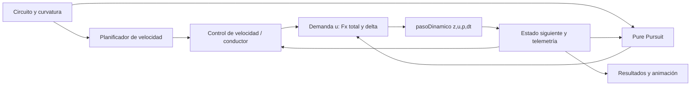

# PROJECT — Vehicle dynamics and stability control

Proyecto de un vehículo Formula Student Driverless. El objetivo final es coordinar ESC, ABS y TCS para mejorar la estabilidad mediante corrección de dirección y frenado selectivo. **La publicación actual reúne la evolución de la planta y los bancos de ensayo hasta V12; esos tres controladores aún no están implementados.**

## Organización

Se respeta la separación original entre las prácticas de la raíz y este proyecto. Los nombres nuevos de carpetas siguen el estilo inglés existente; los archivos MATLAB conservan sus nombres originales.

| Carpeta | Uso |
|---|---|
| [Dynamic Model](Dynamic%20Model/README.md) | Prototipos y modelos V1–V8; subcarpeta Ensayos |
| [Hybrid Tests](Hybrid%20Tests/README.md) | Planta V8 con seguimiento, planificación, estrés V9–V12 y animación |
| [Results](Results/README.md) | Figuras, diez vídeos y datos de 50 ejecuciones |
| [Documentation](Documentation/README.md) | Decisiones, doce etapas, límites e informe intermedio |

## Qué ejecutar

MATLAB R2026a fue el entorno utilizado para verificar las simulaciones recientes y generar los vídeos. No se necesita una biblioteca 3D adicional para la animación con `patch`, `hgtransform` y cámara. No se ha certificado compatibilidad con versiones anteriores.

1. Clonar el repositorio y abrir MATLAB.
2. Para estudiar la planta, seleccionar **PROJECT/Dynamic Model** como Current Folder y ejecutar `CuatroruedasV8_bloqueo_ruedas.mlx`. Sus scripts se buscan en `Ensayos` mediante `pwd`.
3. Para seguimiento y planificación, usar `Prueba_hibrida_V9_PurePursuit_animada.mlx` en **PROJECT/Hybrid Tests**.
4. Para el ensayo actual de un coche, usar `Prueba_hibrida_V11_35ms_3D.mlx`; para la demanda extrema, `Prueba_hibrida_V12_35ms_3D_Aceleracion_agresiva.mlx`.
5. Ejecutar el `.mlx` completo. La animación dispone de pausa, reinicio, deslizador temporal y selección de cámara; al cerrar elimina su temporizador.

Los Live Scripts son los originales archivados. Las carpetas **Source Exports** contienen versiones de texto para inspección y diff, separadas para evitar que un `.m` oculte a un `.mlx` del mismo nombre. No añadir recursivamente todas las exportaciones al path.

## Conexión actual de bloques

Este esquema describe el código existente; no sustituye el futuro diagrama de integración ESC. La planta se mantiene congelada durante la siguiente fase. Su contrato es `[z_next,tele]=pasoDinamico(z,u,p,dt)`; `z_next` incluye todas las memorias, no solo la posición.

## Resultados de referencia

Mismo circuito de estrés de 631.56 m y techo de 35 m/s:

| Configuración | Tiempo de vuelta [s] | Error lateral máximo [m] | Tiempo CG fuera del carril [%] |
|---|---:|---:|---:|
| V10, mapeo base | 51.384 | 1.263 | 0 |
| V11, mapeo exigente | 47.680 | 0.776 | 0 |
| V12, aceleración extrema | 149.036 | 4.347 | 18.103 |

V11 cambia las hipótesis de planificación, no los límites de adherencia de la planta. V12 duplica la fuerza motriz solicitada (2500 → 5000 N) y reduce la constante de aplicación (0.030 → 0.010 s), conservando frenada y dinámica. Véanse [los resultados](Results/README.md) para porcentajes de bloqueo y saturación.

## Qué concluyen y qué no concluyen las pruebas

Las demandas bruscas consumen adherencia y pueden deteriorar mucho el seguimiento. Completar una vuelta no equivale a permanecer en pista ni a validar la física. El criterio de carril usa el centro de gravedad, no toda la carrocería; los porcentajes de bloqueo pertenecen al modo fenomenológico del modelo. La velocidad máxima configurada es un techo y puede no alcanzarse.

La siguiente fase es montar la arquitectura por bloques sin modificar de momento `pasoDinamico`. Las fuerzas independientes por rueda, el controlador de guiñada y la coordinación ABS/TCS siguen pendientes. La futura implementación debe decidir si amplía la física para calcular deslizamiento real o explicita que regula fuerzas con el modelo aproximado.

## Historia y trazabilidad

Consultar [Documentation](Documentation/README.md) para el proceso de diseño, las doce etapas y los problemas de compatibilidad conocidos de los archivos históricos V7 y V9 no animado. Los nombres V1–V8 describen la evolución de la planta; V9–V12 son bancos híbridos que reutilizan esa planta. Los dos archivos `Modelo_cuatroruedasV1/V2` son prototipos paralelos, no versiones adicionales.
