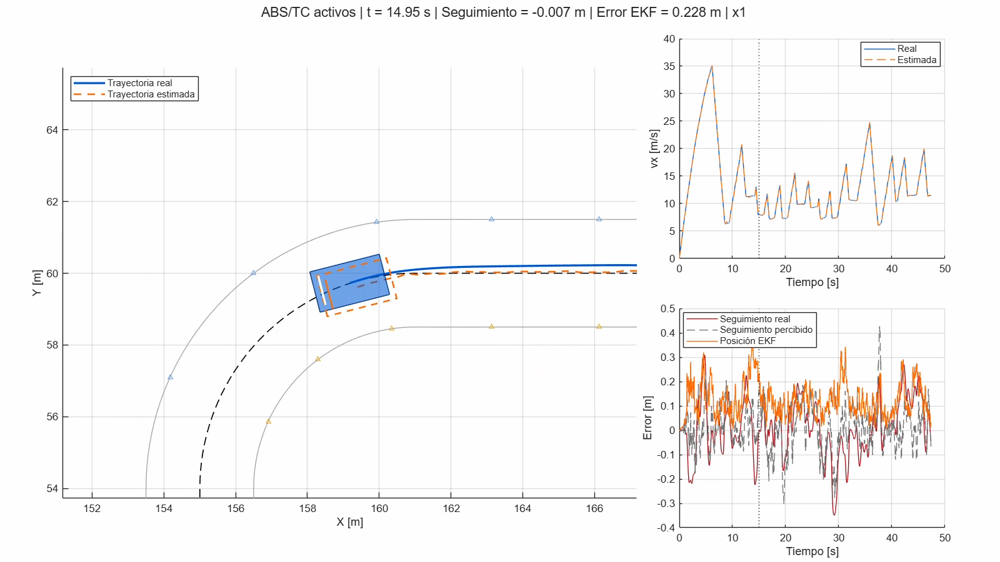
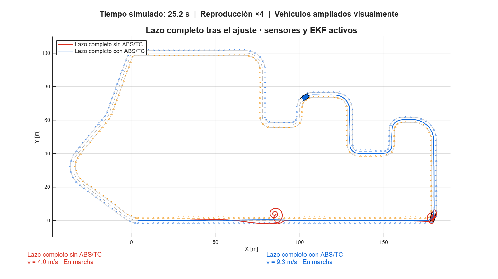
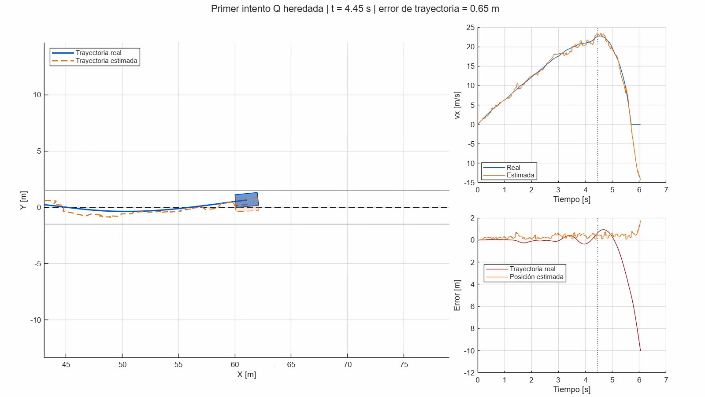
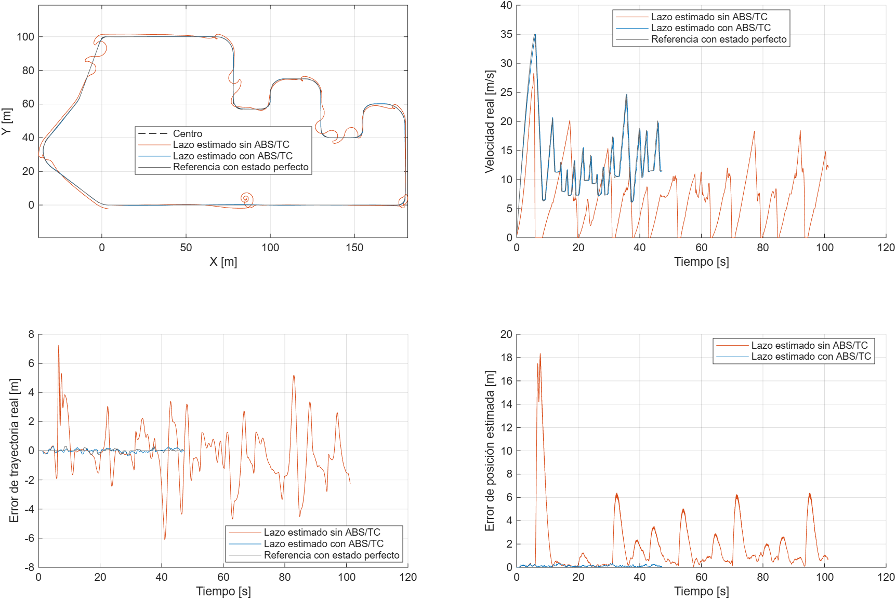
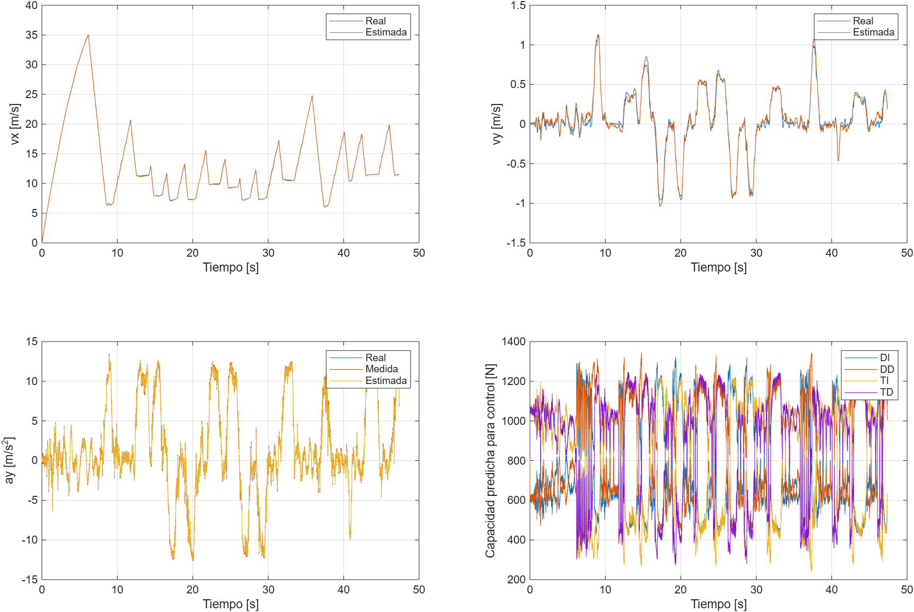

# Complete sensing and estimation loop

**Historical configuration notice:** these successful lap metrics and videos were recorded with reduced Q. Active Q has since been restored to `diag([.02 .02 .005 .10 .10].^2)` with sensor noise and P0 unchanged. No new complete-loop result with restored Q is claimed. The first failed attempt remains a separate historical run. [Latest retained steering test](../Moose_Test_02/README.md).

[← Results](../README.md) · [Run the package](../../Current%20State/README.md) · [Q analysis](../../Documentation/Estimator_Q_and_Failure_Analysis.md)

**After the residual-Q adjustment, the estimated loop with ABS/TC completes a lap in 47.370 s with 0.350 m maximum path error.** Sensors and the EKF are active in both controlled/uncontrolled cases.

| Case | Time s | Maximum path error m | Position RMSE m | vx RMSE m/s | vy RMSE m/s |
|---|---:|---:|---:|---:|---:|
| Estimated loop without ABS/TC | 101.228 | 7.258 | 3.145 | 3.115 | 3.866 |
| Estimated loop with ABS/TC | 47.370 | 0.350 | 0.142 | 0.048 | 0.044 |
| Explicit perfect-state reference | 47.132 | 0.329 | — | — | — |

The uncontrolled case leaves the corridor, despite completing the route. Its severe estimation errors must not be hidden by quoting only the successful controlled run.

## Saved videos with previous reduced Q

**[Real versus estimated trajectory, ABS/TC on](Actual_vs_estimated_ABS_TC_2D.mp4):** normal playback speed, 47.45 s at 20 fps. Blue is real; orange dashed is estimated. The graphs show real/estimated vx, signed true path error, signed path error perceived from the estimate, and the norm of position-estimation error. The last quantity is nonnegative and is not the path-tracking error.

**[ABS/TC on versus off](Closed_loop_ABS_TC_comparison_2D_x4.mp4):** synchronized simulation time, playback ×4, 25.40 s. A car remains at its finish pose after completing its lap. Vehicle markers are enlarged visually in this global view; they are not collision envelopes.

## Failed attempt retained for diagnosis

The first controlled estimated-loop attempt used the inherited Q and crossed 10 m of path error at 6.046 s. The [video](First_Failed_Attempt/First_failed_attempt_2D.mp4), [summary](First_Failed_Attempt/summary.csv) and [histories](First_Failed_Attempt/histories.mat) preserve that failure. It remains a historical failure, not a new run of the restored-Q configuration.

## Numeric evidence

- [Summary](summary.csv) and [full histories](histories.mat), including truth, measurements, estimated states, covariance and controller-owned capacity predictions.
- [Loop checks](loop_checks.json): force-mode arbitration, equal rear driving forces, interface equivalence and exact reproduction of the perfect-state reference.
- [Same-measurement Q replay](same_measurement_Q_replay.csv): isolates the estimator adjustment without changing the physical trajectory or measurements.
- [Straight-line departure chronology](straight_line_departure.csv): records the onset of instability and subsequent estimation deterioration.

## Interpretation

At the first uncontrolled corridor departure, 5.634 s, position-estimation error is only 0.145 m and vx error is 0.026 m/s. The large estimator error develops afterwards. The plant reaches its vx=0 clamp at 6.008 s, which its EKF predictor does not implement. The estimator must therefore be assessed separately from closed-loop vehicle stability. A successful controlled lap is not general validation.

The latest complete-loop renderings are **2D only**. The [earlier modular 3D video](../Modular_Integration/Initial/ABS_TC_realtime_3D.mp4) uses a different, earlier model/configuration; it must not be described as a new 3D rendering of this estimated loop.
