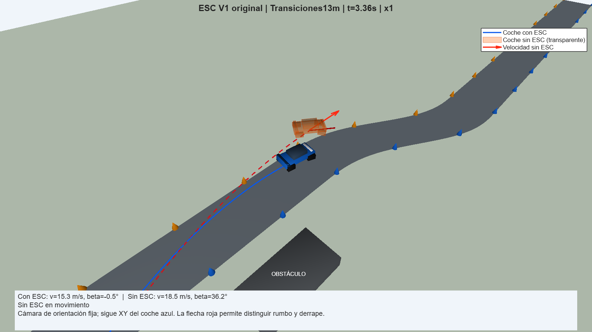

# ESC V1 — 13 m moose-style transitions

[Watch the approved 3D recording](https://horacio135.github.io/Vehicle-Control-Systems/#current) · [Run the scenario](../../Current%20State/Ensayos_ESC/README.md) · [Control theory and implementation](../../Documentation/ESC_V1.md)

**The first selective-braking ESC is implemented and evaluated in a dedicated perfect-state manoeuvre.** Both cars start at 20 m/s and use the same Pure Pursuit, speed-maintenance PI, traction control, modulated ABS, geometry and vehicle dynamics. The longitudinal driver's negative command is suppressed; every applied braking command comes from the ESC. Actual speed remains a dynamic outcome and falls during intervention.

## Recorded outcome

| Metric | Without ESC | With ESC V1 |
|---|---:|---:|
| Maximum vehicle sideslip | 87.8843° | 1.8809° |
| Recorded duration | 3.810 s, aborted | 7.052 s, completes |
| Maximum centre error, evaluated against y-reference at X | 5.0295 m | 1.5205 m |
| Minimum body clearance to corridor edge | −4.6283 m | −0.7016 m |
| Cone contacts | 4 | 3 |
| Obstacle contact | No | No |

The ESC stabilizes the car and completes the manoeuvre, but **does not pass the cone corridor without contact**. The 3.810 s baseline duration is a failure time, not a completion time. These findings belong to this deterministic perfect-state test; they are not validation of the sensing/EKF loop or real-vehicle performance.

## Approved 3D view

[Play the 3D MP4](Alce_ESC_V1_13m_3D_naranja_giro15_opuesto.mp4). The solid blue car has ESC; the orange semitransparent car does not. The red arrow shows the latter's global velocity direction, making sideslip visible relative to body heading. Its recorded pose freezes after the baseline abort; no continuation is extrapolated.

The camera follows only the controlled car's X/Y position. Its height is 12 m, offset is `[-8.6059, -8.6832, 12] m`, field of view is 48°, and its yaw remains fixed throughout the recording. Playback is normal speed, 25 fps, 1600×900. The models remain planar; height and body shape are visualization only. The camera does not rotate with the vehicle.

## Geometry and measurements

The lane-change profile begins at X=40 m, shifts 4 m over a 13 m quintic transition, holds for 10 m and returns over another 13 m transition. Width is 3 m. The 4×2 m obstacle is centred at X=58 m. Both cases use exactly this geometry; the controlled run ends on reaching X=120 m, with a common 15 s time limit.

The corridor check samples the perimeter of a 2×1.2 m body against `yref(X) ± 1.5 m`. Cone contacts use a 0.15 m cone radius against the oriented rectangle; obstacle checks use rectangle separation axes. These are the scenario's declared geometric conventions, not homologation checks. [Verification](Verificacion_corredor.json) · [Metrics CSV](Resumen_ensayos.csv).

## Data and reproduction

- [Full histories and parameters](Ensayos_estabilidad.mat).
- [2D comparison](Comparacion_alce_02_sin_con_ESC_2D.mp4), showing the same data.
- [3D renderer](Renderizar_alce_ESC_V1_13m_3D_naranja_giro15_opuesto.m) and [Live Script](Visualizacion_3D_ESC_V1_13m.mlx), which read the saved MAT and do not simulate again.
- [Render verification](Verificacion_render_3D_naranja_giro15_opuesto.json): unchanged original-data hash, fixed camera direction/height and MP4 decoding checks.

Only source-path metadata in the published MAT has been made portable. Native MATLAB `isequaln` verified identical histories, parameters, summaries and other payloads. The video's verification retains the hash of the original MAT used to render it; repackaging path metadata changes the published MAT's file hash without changing the simulation.

MATLAB variables, comments and recorded labels retain Spanish. Repository documentation is English.
