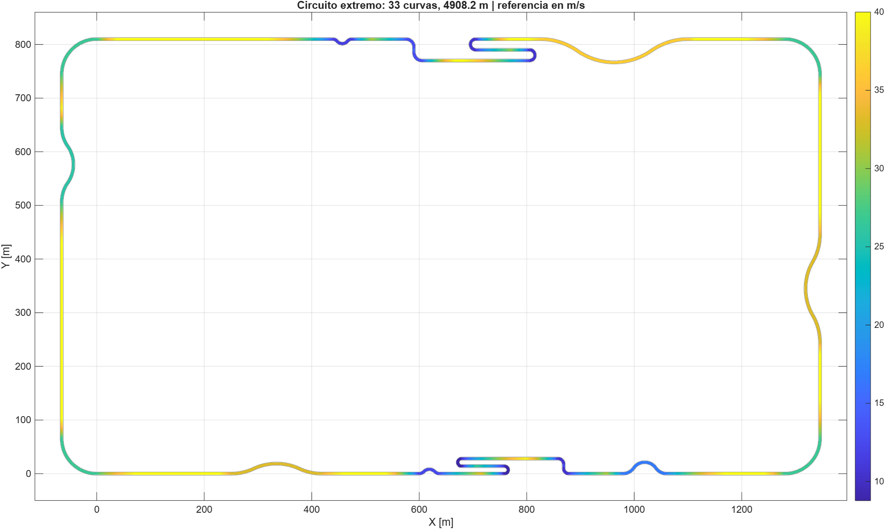

# Extreme 33-corner campaign — 28 November 2026

[Run the scenarios](../../Current%20State/Ensayos_circuito_extremo/README.md) · [Design decisions and force interpretation](../../Documentation/Design_Decisions/Extreme_33_Corners_2026-11-28.md) · [Official gallery](https://horacio135.github.io/Vehicle-Control-Systems/#current)

**The complete noisy sensing/EKF loop now includes ABS, TC and ESC V1 and completes this circuit.** The official 2D recording overlays the actual blue car with its estimated orange dotted footprint. This replaces the temporary gallery-access publication; the video bytes are unchanged.

The closed 4,908.2 m circuit has 33 tangent-connected curves, 6 m width, fast linked bends, chicanes, two hairpin modules and long straights. Reference maximum is 40 m/s; the common curvature planner uses 11 m/s² lateral, 6 m/s² acceleration and 12 m/s² braking bounds. Reference speed is not imposed on the physical state. Pure Pursuit uses `Ld=1+0.15*max(vx,0)` in metres.

## Same controlled car, perfect versus estimated state

| Metric | Perfect state | Sensors + EKF | Change |
|---|---:|---:|---:|
| Lap time | 190.006 s | 191.074 s | +1.068 s / +0.56% |
| Maximum actual centreline error | 0.430057 m | 0.504636 m | +0.074579 m / +17.34% |
| Effective ABS intervention | 17.312 s | 17.540 s | +0.228 s |
| Effective TC intervention | 114.728 s | 118.030 s | +3.302 s |
| Effective ESC intervention | 20.880 s | 25.042 s | +4.162 s / +19.93% |
| Position-estimation RMSE | Not applicable | 0.153999 m | Euclidean X/Y error |

Both complete. Perfect state is an explicit baseline, not a hidden fallback. The full-loop run also replaces access to true tyre memories with the existing controller-owned capacity prediction. Thus the comparison measures the combined sensing/estimation/interface effect, not sensor noise alone. Intervention durations may overlap; a 19.93% increase in ESC time does not establish an equal increase in force or energy. This is one seed, not a statistical robustness study or a full-body cone-contact audit.

Working `Q=diag([.001 .001 .00001 .003 .003].^2)` is unchanged. GPS sigma is 0.5 m, x/y accelerometer sigma 0.2 m/s², gyro sigma 0.01 rad/s and steering sigma 0.1 degrees. IMU/direction sampling is 2 ms; GPS is every 25 steps. Seed is 1. The first five estimator states start with `P0=eye(5)*1e-3`; the existing internal augmentation is unchanged. No sensor noise was reduced. The capacity calculation needed zero load projections.

## Separate the retained campaigns

| Folder | Evidence and scope |
|---|---|
| [Complete_Loop](Complete_Loop/README.md) | Official x1 2D video, complete histories, actual/estimated poses, Q/noise verification |
| [Perfect_State](Perfect_State/README.md) | Four-aid comparison and per-wheel force/capacity evidence; first three cases lose control early |
| [ESC_Recovery](ESC_Recovery/README.md) | ABS+TC with/without ESC, whole-track view; original aggressive driving resumes after every temporary recovery |
| [Telemetry_Perfect_State](Telemetry_Perfect_State/README.md) | Controlled perfect-state 2D/3D videos with synchronized aid, force, capacity and steering plots |

## Academic interpretation

The model qualitatively reproduces the main adhesion-loss phenomena and the coordinated action of the driving aids. Its results are physically plausible within the adopted assumptions, while quantitative agreement with a particular real vehicle would require parameter identification and experimental validation.

This academic project intentionally defines ABS/TC through requested-versus-available force. Replacing them with production wheel-slip feedback regulators or conducting experimental tyre identification is not a prerequisite for completing that stated scope. The assumptions, tests and limits must remain explicit. Additional noise seeds, targeted aid ablations and emergency scenarios are the appropriate next validation steps.

## Reproducibility records

[Comparison CSV](Perfect_vs_estimated.csv) · [Artifact hashes and unchanged core](../../Documentation/extreme_33_artifact_manifest.json) · [MATLAB portability checks](Verificacion_portabilidad.json). The two recorded complete-loop runs use the same physical/control parameters; only sensing, estimation and their input interface differ.
