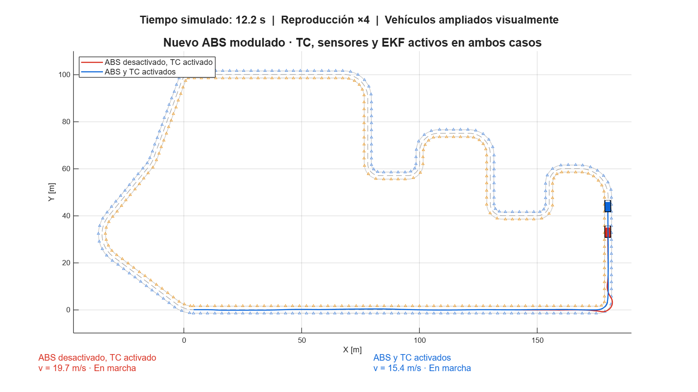
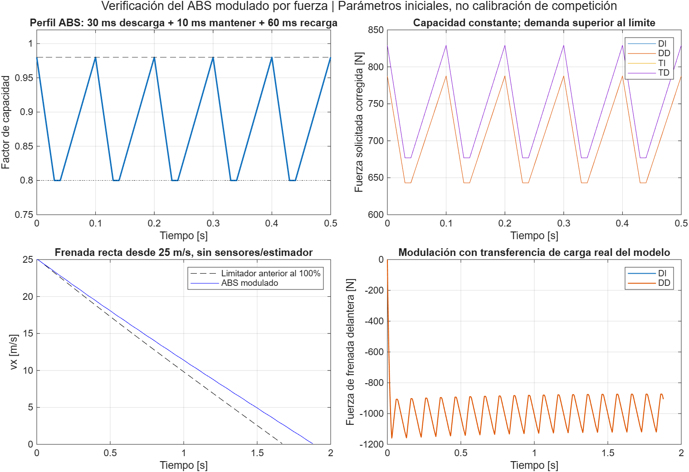

# Modulated force-based ABS — 27 November 2026

[Current runnable package](../../Current%20State/README.md) · [Watch the comparison](https://horacio135.github.io/Vehicle-Control-Systems/#current) · [Design and sources](../../Documentation/Design_Decisions/Modulated_ABS_2026-11-27.md)

The instantaneous braking limiter has been replaced with independent discharge, hold and rebuild phases for each wheel. The physical plant, TC, sensor errors and EKF equations are unchanged. The selected working configuration again uses `Q = diag([.001 .001 .00001 .003 .003].^2)`.

## Fourteen-corner circuit

Both cases use TC, sensors and estimation, with the same seed, driver and speed profile. Only `p.abs.habilitado` differs. This is **not** the older comparison with both ABS and TC switched off.

| Case | Lap time [s] | Maximum path error [m] | RMS path error [m] | Position EKF RMSE [m] |
|---|---:|---:|---:|---:|
| ABS off, TC on | 49.250 | 2.016 | 0.44153 | 0.14452 |
| Modulated ABS on, TC on | 47.294 | 0.35427 | 0.12288 | 0.14233 |

Both complete the route. The controlled run is 1.956 s faster in this seed-1 simulation. Completion is not a body/cone collision check or a robustness demonstration.

- [ABS off/on comparison, TC on in both, playback ×4](Circuit_14/Comparacion_ABS_off_on_TC_on_2D_x4.mp4).
- [ABS/TC on: actual and estimated positions, normal speed](Circuit_14/ABS_TC_on_real_estimado_2D.mp4).
- [Complete histories](Circuit_14/lazo_completo.mat), [metrics](Circuit_14/resumen.csv), [trajectory/forces](Circuit_14/comparacion_lazo.png), [estimation and capacity](Circuit_14/estimacion_y_capacidad.png).

`sinControl` in the MAT file is a retained legacy variable name: it means **ABS off / TC on** here. `conControl` means both on. `pSinABS` and `pConABS` record the switches explicitly. `verificar_resultados.m` checks TC intervention in both and ABS intervention only in the enabled case, and decodes the start, middle and end of both MP4s. Renderers resolve data relative to their own directory.

## Bench evidence

[Profile and straight-line checks](Bench/verificacion_ABS.json) verify 0.98→0.80→0.98, 30/10/60 ms phases, independent wheels, memory/reset behaviour, positive-demand passthrough and matching 1/2 ms time steps. From 25 m/s to below 0.1 m/s, the previous ideal limiter takes 1.672 s / 20.696 m; modulation takes 1.880 s / 23.164 m. Periodic release lengthens braking relative to an ideal capacity limiter; this is not claimed as a stopping-distance improvement.

Run `Bench/verificar_abs_modulado.m` to exercise the selected package against the preserved `controlABSAnterior.m`. Tests write their outputs beside the script. Recorded labels and MATLAB comments remain Spanish.
