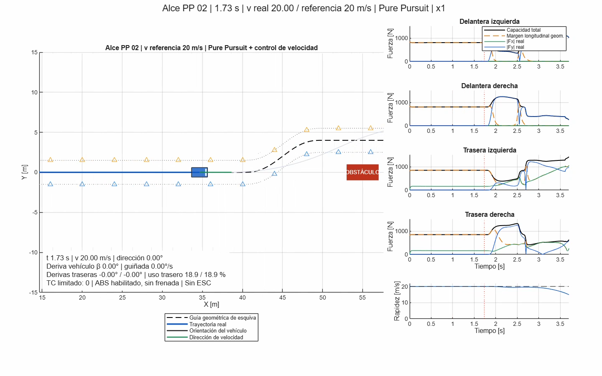
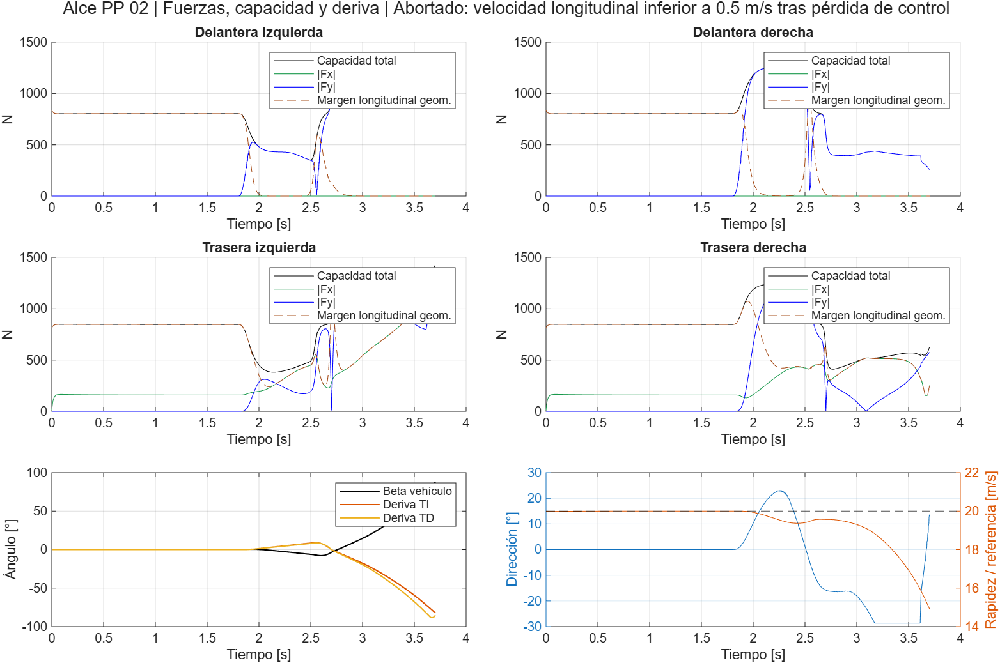

# Retained moose-style test 02

[← Results](../README.md) · [Run the scenario](../../Current%20State/Ensayos_alce_seguimiento/README.md) · [Design decision](../../Documentation/Design_Decisions/Q_Restoration_and_Moose_Test_2026-11-26.md) · [Watch in the gallery](https://horacio135.github.io/Vehicle-Control-Systems/)

**This is a failed exploratory manoeuvre, not a successful avoidance or an ISO-certified moose test.** It is the only retained result from the recent steering-test campaigns. The earlier eight-case battery and the other three Pure Pursuit cases were deliberately deleted locally and are not published.

| Parameter / result | Value |
|---|---:|
| Constant speed reference | 20 m/s |
| Lateral lane displacement | 4 m |
| Each lane-change transition | 10 m |
| First transition starts at | X = 40 m |
| Displaced straight section | 10 m |
| Recorded duration | 3.704 s |
| Maximum speed-magnitude error | 5.099 m/s |
| Speed-magnitude error RMSE | 1.182 m/s |
| Maximum equivalent front steering angle | 28.648 degrees |
| Samples with TC force limiting | 352 |
| Samples with ABS limiting | 0 |

The current Pure Pursuit and longitudinal modules drive the existing hybrid plant. ABS/TC are enabled; sensors, EKF, emergency control and ESC are omitted. The longitudinal module receives true speed magnitude through an explicit scalar interface adapter. The scenario disables full-pedal hysteresis (`errorActivar=Inf`) to use its existing maintenance PI, retaining its original gains. Negative force requests are clipped at zero to preserve the no-braking condition. Rear driving requests remain equal.

The speed **reference** is constant; actual speed is not imposed. Tracking and speed regulation fail. Recording stops when body-frame vx falls below 0.5 m/s, avoiding continued integration into the plant's vx clamp. No visual obstacle contact was recorded before termination; this does not establish successful avoidance. The obstacle and 2.0 by 1.2 m body rectangles are illustrative and no impact forces are simulated. Large slip angles are qualitative evidence within a simplified planar model, not experimental tyre validation.

## Video and figures

[Download the normal-speed MP4](Alce_PP_02_2D_capacidad.mp4). The video displays true motion, reference path, wheel forces/capacity and actual speed against its fixed reference.

Black: total force-circle radius. Orange dashed: geometric longitudinal margin computed from actual lateral force, not an ABS/TC input. Green/blue: absolute actual longitudinal/lateral forces. The [editable MATLAB figure](Alce_PP_02_graficas.fig) and [maximum-drift frame](Alce_PP_02_deriva_maxima.png) are retained.

## Data and provenance

- [Single-case MAT history](Ensayos_estabilidad.mat): exactly one history, case and summary, with original parameters and historical provenance. Embedded workstation paths in the MAT are historical metadata; public scripts resolve repository paths.
- [Summary CSV](Resumen_ensayos.csv) and [JSON](Resumen_ensayos.json).
- [Visual-contact record](Contacto_obstaculo_visual.csv).
- [Original source hashes](Integridad_bloques.json), [video verification](Verificacion_videos.json), and [run checks](Verificacion_final.json).

Q restoration does not alter this result because the manoeuvre bypasses sensors and estimation. Provenance hashes describe the recorded run; the integration-Q configuration changed afterwards. No complete estimated-loop run has been repeated with restored Q.
