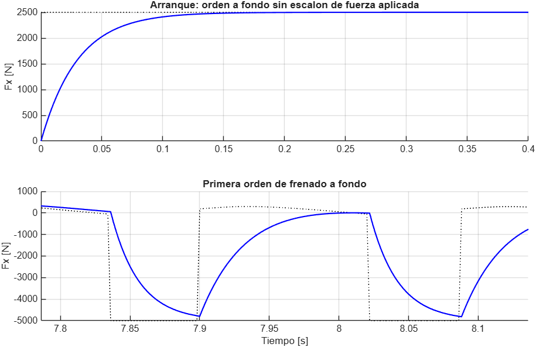

# V10 · Stress testing

[← Results](../README.md) · [Metrics and telemetry](../Numerical/README.md)

Two campaigns are retained. Circuit/force figures come from the first, at 6/10/14/18/22 m/s; the dated video uses 15/20/25/30/35 m/s. They must not be conflated.

| Case | Speed cap [m/s] | Time [s] | Lap/stop reached | Max. error [m] | CG outside [%] | Lock mode [%] |
|---|---:|---:|---|---:|---:|---:|
| case_01 | 6 | 103.584 | Yes | 1.276 | 0.000 | 0.071 |
| case_02 | 10 | 67.244 | Yes | 1.295 | 0.000 | 3.108 |
| case_03 | 14 | 57.384 | Yes | 1.290 | 0.000 | 7.368 |
| case_04 | 18 | 53.878 | Yes | 1.284 | 0.000 | 10.156 |
| case_05 | 22 | 52.456 | Yes | 1.279 | 0.000 | 11.320 |

### Later campaign

| Case | Speed cap [m/s] | Time [s] | Lap/stop reached | Max. error [m] | CG outside [%] | Lock mode [%] |
|---|---:|---:|---|---:|---:|---:|
| case_01 | 15 | 56.134 | Yes | 1.274 | 0.000 | 8.102 |
| case_02 | 20 | 53.028 | Yes | 1.279 | 0.000 | 10.866 |
| case_03 | 25 | 51.970 | Yes | 1.277 | 0.000 | 11.583 |
| case_04 | 30 | 51.510 | Yes | 1.288 | 0.000 | 11.908 |
| case_05 | 35 | 51.384 | Yes | 1.263 | 0.000 | 12.276 |

## Recorded artifacts

- [Circuit and trajectories](circuito_y_trayectorias.png)
- [Requested and applied forces](fuerzas.png)
- [Driver-demand transitions](transiciones.png)
- [15–35 m/s campaign preview](vista_previa_15_35.png)

## Preview

