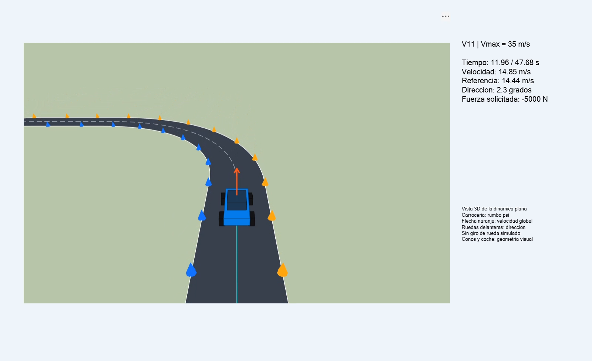

# V11 — un coche en 3D

Mismo resultado que el caso 35 m/s del mapeo exigente; únicamente cambia la presentación. El coche tiene volumen visual, dirección delantera y cámara de seguimiento. No se modela suspensión ni giro de rueda.

| Caso | Vmax [m/s] | Tiempo [s] | Vuelta/parada | Error máx. [m] | CG fuera [%] | Bloqueo [%] |
|---|---:|---:|---|---:|---:|---:|
| hist35 | 35 | 47.680 | Sí | 0.776 | 0.000 | 19.869 |

## Artefactos

- [vista_previa.png](vista_previa.png)

[Métricas y telemetría](../Numerical/README.md) · [Índice general](../README.md)
