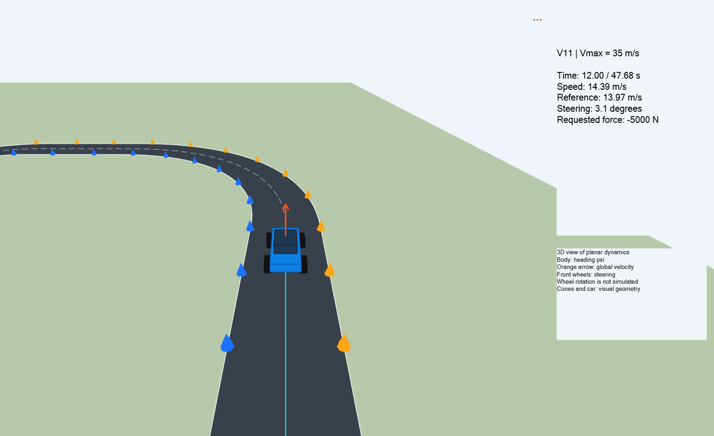

# V11 · One car in 3D

[← Results](../README.md) · [Metrics and telemetry](../Numerical/README.md)

This is the demanding-map 35 m/s result with a different presentation only. The car has visual volume, front-wheel steering and a chase camera. Suspension and wheel rotation are not simulated.

| Case | Speed cap [m/s] | Time [s] | Lap/stop reached | Max. error [m] | CG outside [%] | Lock mode [%] |
|---|---:|---:|---|---:|---:|---:|
| hist35 | 35 | 47.680 | Yes | 0.776 | 0.000 | 19.869 |

## Recorded artifacts

- [Simulation preview](vista_previa.png)

## Preview

