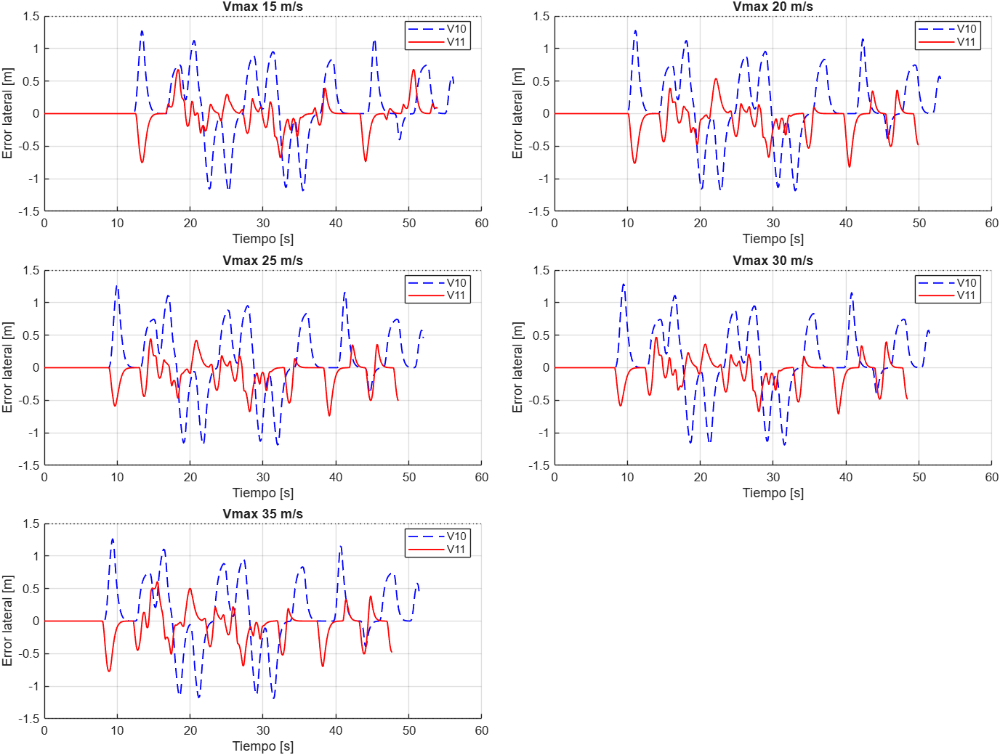

# V11 · Demanding speed mapping

[← Results](../README.md) · [Metrics and telemetry](../Numerical/README.md)

The initial comparison uses 15/20/25/30/35 m/s caps. Later video/data use 25/30/32/35/40. At 35 m/s, the baseline takes 51.384 s and the demanding map 47.680 s; approximate lock time increases from 12.276% to 19.869%. Maximum braking-force demand is not reduced.

| Case | Speed cap [m/s] | Time [s] | Lap/stop reached | Max. error [m] | CG outside [%] | Lock mode [%] |
|---|---:|---:|---|---:|---:|---:|
| case_01 | 25 | 48.568 | Yes | 0.741 | 0.000 | 18.464 |
| case_02 | 30 | 48.428 | Yes | 0.711 | 0.000 | 19.075 |
| case_03 | 32 | 47.850 | Yes | 0.783 | 0.000 | 19.598 |
| case_04 | 35 | 47.680 | Yes | 0.776 | 0.000 | 19.869 |
| case_05 | 40 | 47.590 | Yes | 0.896 | 0.000 | 20.083 |

## Recorded artifacts

- [Compared lateral error](error_comparado.png)
- [25–40 m/s campaign preview](vista_previa_25_40.png)

## Preview

