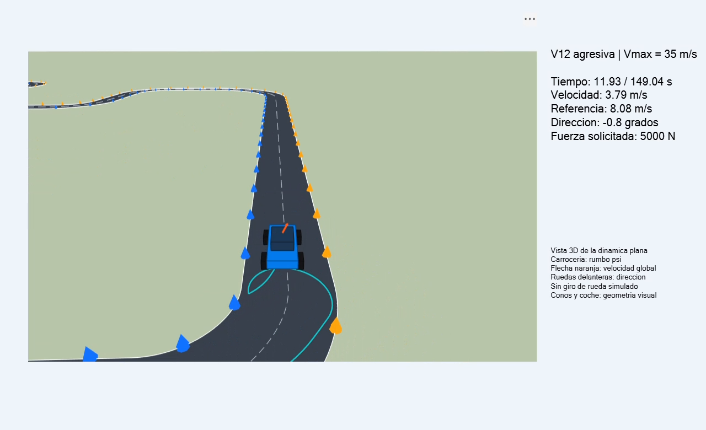

# V12 — aceleración extrema

Se conserva el caso desfavorable: tracción solicitada máxima 5000 N y tauAcel=0.010 s. Frenada y ecuaciones físicas permanecen iguales. El exceso longitudinal trasero durante aceleración pasa del 49.664 al 98.556 % y el factor lateral mínimo de 0.153 a 0.078.

| Caso | Vmax [m/s] | Tiempo [s] | Vuelta/parada | Error máx. [m] | CG fuera [%] | Bloqueo [%] |
|---|---:|---:|---|---:|---:|---:|
| hist35 | 35 | 149.036 | Sí | 4.347 | 18.103 | 3.225 |

La vuelta completa no es una vuelta dentro de pista: el CG pasa un 18.103 % del tiempo fuera. Esta configuración sirve para comprobar la futura intervención de estabilidad, no para afirmar que ya se ha diseñado un ESC.

## Artefactos

- [vista_previa.png](vista_previa.png)

[Métricas y telemetría](../Numerical/README.md) · [Índice general](../README.md)
