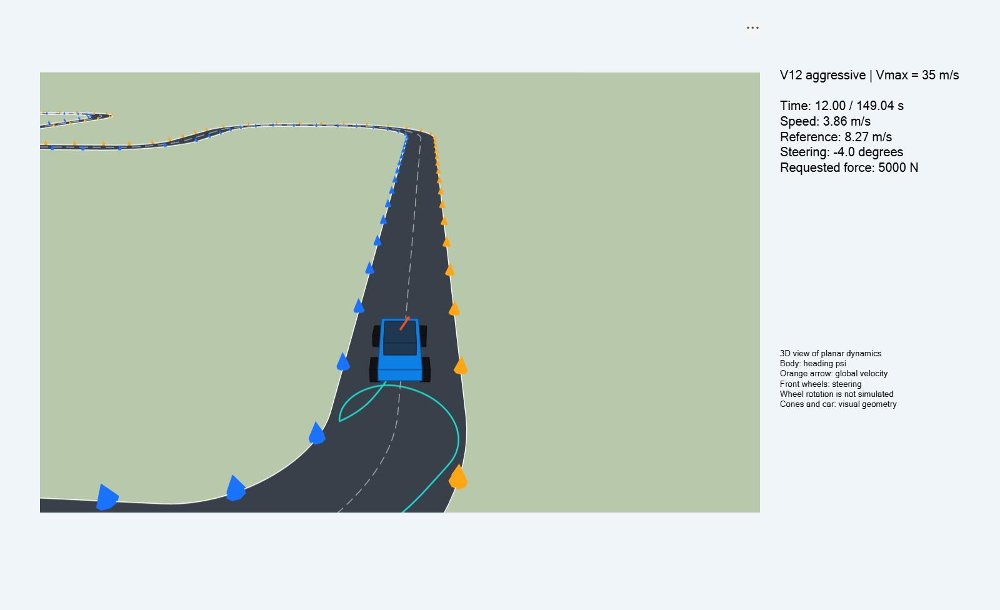

# V12 · Extreme acceleration

[← Results](../README.md) · [Metrics and telemetry](../Numerical/README.md)

The adverse case is retained: 5000 N maximum drive demand and tauAcel=0.010 s. Braking and physical equations are unchanged. Rear longitudinal excess during acceleration rises from 49.664% to 98.556%, and minimum lateral factor falls from 0.153 to 0.078.

| Case | Speed cap [m/s] | Time [s] | Lap/stop reached | Max. error [m] | CG outside [%] | Lock mode [%] |
|---|---:|---:|---|---:|---:|---:|
| hist35 | 35 | 149.036 | Yes | 4.347 | 18.103 | 3.225 |

Completing the lap does not mean staying on track: the CG is outside for 18.103% of recorded time. This is a future stability-intervention test, not evidence of an already-designed ESC.

## Recorded artifacts

- [Simulation preview](vista_previa.png)

## Preview

