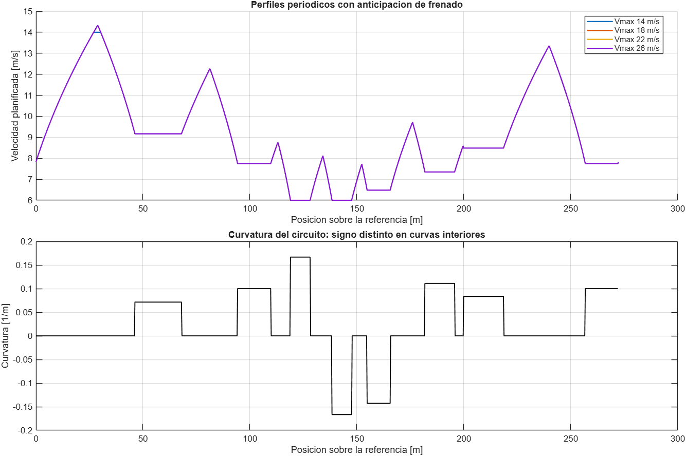

# V9 · Curvature-based speed planning

[← Results](../README.md) · [Metrics and telemetry](../Numerical/README.md)

The first four-cap campaign predates the fourteen-corner circuit. Geometry and the planner constrain achievable speed: 18/22/26 m/s caps produce nearly identical responses.

| Case | Speed cap [m/s] | Time [s] | Lap/stop reached | Max. error [m] | CG outside [%] | Lock mode [%] |
|---|---:|---:|---|---:|---:|---:|
| case_01 | 14 | 30.436 | Yes | 1.017 | 0.000 | 0.000 |
| case_02 | 18 | 30.432 | Yes | 1.017 | 0.000 | 0.000 |
| case_03 | 22 | 30.432 | Yes | 1.017 | 0.000 | 0.000 |
| case_04 | 26 | 30.432 | Yes | 1.017 | 0.000 | 0.000 |

### Five-case animated campaign

| Case | Speed cap [m/s] | Time [s] | Lap/stop reached | Max. error [m] | CG outside [%] | Lock mode [%] |
|---|---:|---:|---|---:|---:|---:|
| case_01 | 6 | 44.164 | Yes | 1.015 | 0.000 | 0.000 |
| case_02 | 10 | 31.628 | Yes | 1.019 | 0.000 | 0.000 |
| case_03 | 14 | 30.436 | Yes | 1.017 | 0.000 | 0.000 |
| case_04 | 18 | 30.432 | Yes | 1.017 | 0.000 | 0.000 |
| case_05 | 22 | 30.432 | Yes | 1.017 | 0.000 | 0.000 |

## Recorded artifacts

- [Acceleration and braking](aceleracion_y_frenado.png)
- [Circuit and trajectories](circuito_y_trayectorias.png)
- [Planned speed profiles](perfiles_de_velocidad.png)
- [Reference and speed-controller response](referencia_y_respuesta.png)

## Preview

